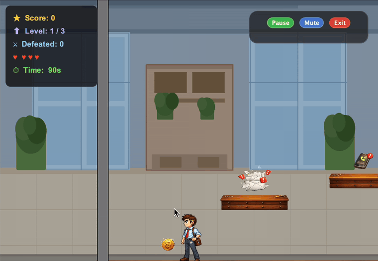

# Office Escape

A 2D platformer written in Java, set in an office overrun by its worst distractions. Fight your way past flying emails, ringing phones and a meeting that won't stop following you, across three levels against the clock.



## Gameplay

- **Three levels** of increasing difficulty, each with its own layout and background
- **Two enemy behaviours**: enemies that bob up and down on a sine wave, and a chaser that tracks the player's position every physics step and gets faster each level
- **Projectile combat**: throw paper balls in the direction you're facing to destroy enemies
- **90-second timer** per level: run out of time and you lose a life
- **Lives and scoring**: 3 lives, points for each enemy defeated, and a bonus for lives remaining at the end of each level
- **Persistent high score** saved to disk, so it survives between sessions
- **Start and end screens**, with Play Again on the end screen
- **In-game controls** to pause, mute the music or exit
- **Scrolling camera** that follows the player across levels wider than the window
- **Sound effects** for hits and background music

A level is complete once every enemy has been defeated and the coin has been collected.

## Controls

| Key | Action |
|---|---|
| ← / → | Move left / right |
| ↑ | Jump |
| Space | Throw a paper ball |

## How it's built

The game uses Java Swing for the window and interface, on top of a JBox2D-based 2D physics engine.

- `GameLevel` is an abstract class that every level extends. It sets up the player and level boundaries, and each subclass (`Level1`, `Level2`, `Level3`) defines its own layout, start position, background and completion condition. Adding a level means writing one new subclass.
- `Game` manages the window, level transitions, lives, score, the countdown timer and the camera.
- Enemy movement is split into separate step listeners (`EnemyMove`, `ChaserMove`, `CoinMove`), so each behaviour is reusable and can be tuned per level by passing in a different speed.
- Collisions are handled by dedicated listeners: `PlayerHit` (with a cooldown so a single contact can't take several lives) and `EnemyHit` for projectiles.
- `HighScoreManager` reads and writes the high score to `data/highscore.txt`, and falls back to 0 if the file is missing.

```
src/game/
├── Game.java              Entry point, game state, timers, level transitions
├── GameLevel.java         Abstract base for all levels
├── Level1/2/3.java        Level layouts and completion rules
├── Player.java, Enemy.java, Coin.java, PaperBall.java
├── Platform.java, Ground.java, Wall.java
├── EnemyMove.java, ChaserMove.java, CoinMove.java    Movement behaviours
├── PlayerHit.java, EnemyHit.java                    Collision handling
├── Control.java           Keyboard input
├── GameView.java          Rendering and HUD
├── Buttons.java           Pause / Mute / Exit panel
├── StartScreen.java, EndScreen.java
└── HighScoreManager.java  High score persistence
data/                      Sprites, backgrounds and sound
```

## Running it

Requirements: a Java JDK and the City, University of London `city.cs.engine` library (a teaching wrapper around JBox2D), which is not included in this repository.

1. Clone the repository:
   ```bash
   git clone https://github.com/N4staa/Office-Escape.git
   ```
2. Open the project in IntelliJ IDEA and add the `city.cs.engine` library to the module's dependencies.
3. Run `game.Game`.

Run it from the project root so the `data/` folder is found.

## Background

I built Office Escape for the Java programming module in my first year of BSc Computer Science at City St George's, University of London. The physics engine was provided for the module; the game design, levels, enemy behaviours, scoring, screens and all other game code are my own.

## Author

**Anastasia Spiner**, BSc Computer Science student at City St George's, University of London
